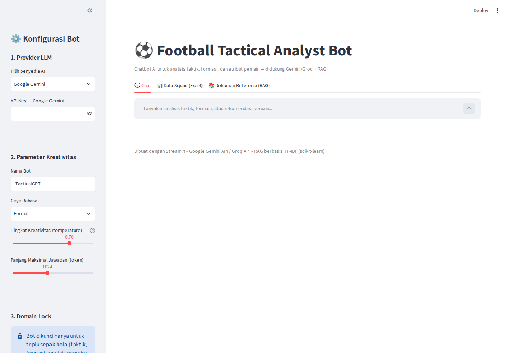
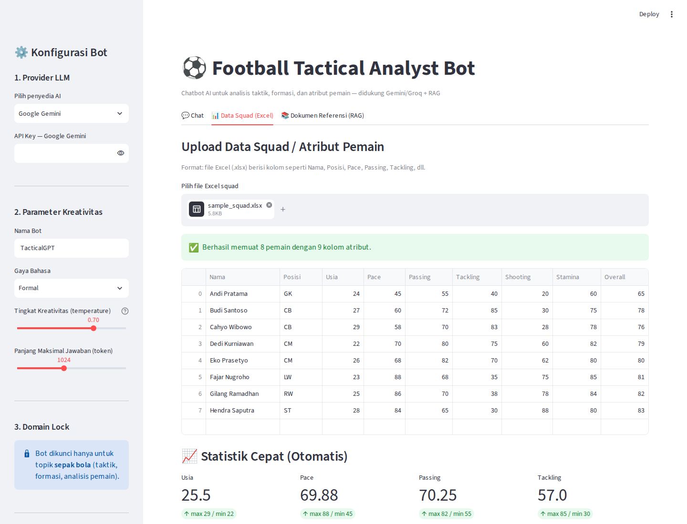
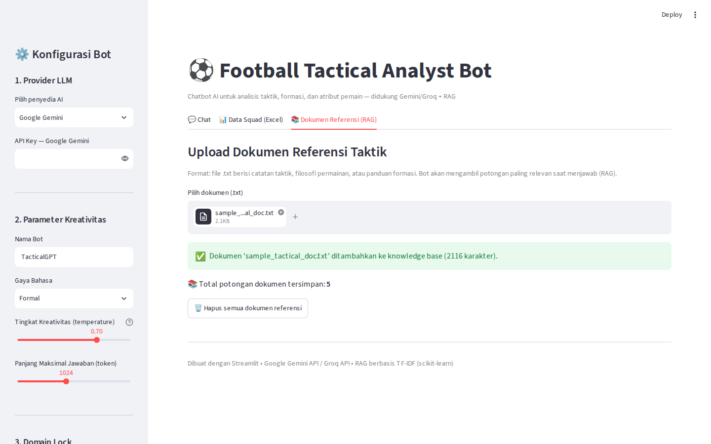

# ⚽ Football Tactical Analyst Bot

Chatbot berbasis AI (LLM) untuk **analisis taktik sepak bola** — menggunakan **Google Gemini API** atau **Groq API**, dengan input data squad/atribut pemain (Excel) dan dokumen referensi taktik (RAG). Dibangun dengan **Streamlit** agar mudah dijalankan, gratis, dan tidak rumit.



---

## 📋 Daftar Isi

- [Fitur Utama](#-fitur-utama)
- [Arsitektur & Parameter Kreatif](#-arsitektur--parameter-kreatif)
- [Screenshot UI](#-screenshot-ui)
- [Tools yang Digunakan (Semua Gratis)](#-tools-yang-digunakan-semua-gratis)
- [Guideline Step-by-Step](#-guideline-step-by-step)
- [Struktur Proyek](#-struktur-proyek)
- [Deploy Gratis ke Streamlit Cloud](#-deploy-gratis-ke-streamlit-cloud)
- [Contoh Penggunaan](#-contoh-penggunaan)
- [Catatan Keamanan](#-catatan-keamanan)

---

## 🎯 Fitur Utama

| Fitur | Deskripsi |
|---|---|
| **Multi-LLM Provider** | Pilih antara Google Gemini API atau Groq API secara real-time dari UI |
| **Input Excel Squad** | Upload data atribut pemain (.xlsx) — otomatis diringkas & dianalisis |
| **RAG Dokumen Taktik** | Upload dokumen referensi (.txt) — bot mengambil potongan paling relevan sebelum menjawab |
| **Domain Lock** | Bot dikunci hanya menjawab topik sepak bola (taktik, formasi, analisis pemain) |
| **Gaya Bahasa Kustom** | Formal, Santai, atau Teknis/Detail — dapat diubah kapan saja |
| **Kontrol Kreativitas** | Slider *temperature* (0.0–1.0) mengatur variasi jawaban |
| **Memory Percakapan** | Bot mengingat histori chat dalam satu sesi, bisa di-reset kapan saja |
| **Statistik Otomatis** | Rata-rata, max, min setiap atribut numerik langsung tampil setelah upload |

---

## 🏗️ Arsitektur & Parameter Kreatif

```
┌─────────────────┐     ┌──────────────────┐     ┌─────────────────┐
│  Excel Squad     │────▶│                  │     │                 │
│  (.xlsx)         │     │   Streamlit UI   │────▶│  System Prompt  │
└─────────────────┘     │   (app.py)       │     │  Builder        │
┌─────────────────┐     │                  │     │                 │
│  Dokumen Taktik  │────▶│  - Sidebar       │     └────────┬────────┘
│  (.txt) → RAG    │     │  - Chat          │              │
│  (TF-IDF)        │     │  - Tabs          │              ▼
└─────────────────┘     └──────────────────┘     ┌─────────────────┐
                                                    │  LLM Client     │
                                                    │  - Gemini API   │
                                                    │  - Groq API     │
                                                    └─────────────────┘
```

**Parameter kreatif yang dikonfigurasi pengguna:**
1. **Provider** — Google Gemini / Groq (dan pilihan model Groq: llama-3.3-70b, llama-3.1-8b, mixtral-8x7b)
2. **Nama Bot** — dipakai bot untuk memperkenalkan diri
3. **Gaya Bahasa** — Formal / Santai / Teknis-Detail (mengubah system prompt)
4. **Temperature** — tingkat kreativitas/variasi jawaban (0.0 = konsisten, 1.0 = variatif)
5. **Max Tokens** — panjang maksimal jawaban
6. **Domain Lock** — hardcoded di system prompt agar bot menolak topik di luar sepak bola

---

## 📸 Screenshot UI

### 1. Chat Interface + Konfigurasi Sidebar


### 2. Upload & Analisis Data Squad (Excel)


### 3. Upload Dokumen Referensi Taktik (RAG)


---

## 🛠️ Tools yang Digunakan (Semua Gratis)

| Tool | Fungsi | Biaya |
|---|---|---|
| [Streamlit](https://streamlit.io/) | Framework UI web Python | Gratis (open-source) |
| [Google Gemini API](https://ai.google.dev/) | LLM utama (gemini-2.0-flash) | Gratis (free tier generous) |
| [Groq API](https://console.groq.com/) | LLM alternatif (super cepat, Llama 3.3) | Gratis (free tier) |
| [scikit-learn](https://scikit-learn.org/) | Retrieval RAG berbasis TF-IDF (ringan, tanpa GPU) | Gratis (open-source) |
| [pandas + openpyxl](https://pandas.pydata.org/) | Membaca & mengolah file Excel | Gratis (open-source) |
| [Streamlit Community Cloud](https://streamlit.io/cloud) | Hosting/deploy gratis | Gratis |
| [GitHub](https://github.com/) | Version control & hosting repo | Gratis |

> 💡 RAG sengaja dibuat dengan **TF-IDF (scikit-learn)**, bukan embedding model besar (seperti `sentence-transformers`), supaya ringan, cepat dijalankan, dan tidak memerlukan resource/GPU besar — cocok untuk deploy gratis.

---

## 🚀 Guideline Step-by-Step

### A. Menjalankan di Lokal

**1. Clone repository**
```bash
git clone <URL_REPO_GITHUB>
cd football-tactical-bot
```

**2. Buat virtual environment (opsional tapi disarankan)**
```bash
python -m venv venv
source venv/bin/activate      # Linux/Mac
venv\Scripts\activate         # Windows
```

**3. Install dependencies**
```bash
pip install -r requirements.txt
```

**4. Dapatkan API Key gratis**
- **Gemini**: buka [aistudio.google.com/apikey](https://aistudio.google.com/apikey) → login Google → klik "Create API Key" → salin.
- **Groq**: buka [console.groq.com/keys](https://console.groq.com/keys) → daftar/login → klik "Create API Key" → salin.

**5. Jalankan aplikasi**
```bash
streamlit run app.py
```
Aplikasi akan terbuka otomatis di `http://localhost:8501`.

**6. Konfigurasi bot di sidebar**
- Pilih provider (Gemini/Groq)
- Tempel API Key
- Atur nama bot, gaya bahasa, temperature, max token

**7. Upload data (opsional tapi disarankan)**
- Tab **"Data Squad (Excel)"** → upload file `.xlsx` (lihat contoh di `data/sample_squad.xlsx`)
- Tab **"Dokumen Referensi (RAG)"** → upload file `.txt` berisi catatan taktik (lihat contoh di `data/sample_tactical_doc.txt`)

**8. Mulai chat**
- Buka tab **"Chat"**, ketik pertanyaan, misalnya:
  - *"Formasi apa yang cocok untuk skuad saya berdasarkan rata-rata stamina?"*
  - *"Siapa pemain terbaik untuk peran gelandang box-to-box?"*

---

### B. Format File Input

**Excel Squad** — kolom bebas, minimal punya kolom `Nama` dan atribut numerik:

| Nama | Posisi | Usia | Pace | Passing | Tackling | Shooting | Stamina | Overall |
|---|---|---|---|---|---|---|---|---|
| Andi Pratama | GK | 24 | 45 | 55 | 40 | 20 | 60 | 65 |
| ... | ... | ... | ... | ... | ... | ... | ... | ... |

**Dokumen Taktik (.txt)** — bebas format naratif, contoh ada di `data/sample_tactical_doc.txt`. Semakin terstruktur dan jelas, semakin baik hasil retrieval RAG.

---

## 📁 Struktur Proyek

```
football-tactical-bot/
├── app.py                        # Aplikasi utama Streamlit
├── requirements.txt               # Daftar dependency
├── README.md                      # Dokumentasi ini
├── .gitignore
├── utils/
│   ├── excel_parser.py           # Parsing & ringkasan data squad Excel
│   ├── rag_engine.py             # RAG ringan berbasis TF-IDF
│   └── llm_client.py             # Wrapper Gemini API & Groq API
├── data/
│   ├── sample_squad.xlsx         # Contoh data squad untuk testing
│   └── sample_tactical_doc.txt   # Contoh dokumen taktik untuk RAG
└── screenshots/
    ├── 01_chat_tab.png
    ├── 02_data_squad_tab.png
    └── 03_rag_docs_tab.png
```

---

## ☁️ Deploy Gratis ke Streamlit Cloud

1. Push repo ini ke akun GitHub kamu (lihat bagian [Guideline](#-guideline-step-by-step) di atas).
2. Buka [share.streamlit.io](https://share.streamlit.io/) → login dengan GitHub.
3. Klik **"New app"** → pilih repo `football-tactical-bot` → branch `main` → file utama `app.py`.
4. Klik **Deploy**. Tunggu beberapa menit hingga build selesai.
5. Aplikasi akan mendapat URL publik seperti `https://<nama-app>.streamlit.app`.
6. API Key tetap dimasukkan pengguna langsung di sidebar (tidak disimpan di server) — jadi aman untuk deploy publik.

---

## 💬 Contoh Penggunaan

**Pertanyaan dalam domain (dijawab):**
> "Berdasarkan data squad saya, formasi apa yang paling cocok?"

**Pertanyaan di luar domain (ditolak sesuai domain lock):**
> "Bagaimana cara memasak nasi goreng?"
> → Bot akan menolak sopan dan mengarahkan kembali ke topik sepak bola.

---

## 🛠️ Troubleshooting

**Error `model_not_found` / `does not exist or you do not have access to it` (Groq)**

Groq kadang menonaktifkan atau membatasi akses model tertentu per akun/wilayah, meski model itu masih tercantum di dokumentasi resmi. Solusi:
1. Buka dropdown **"Model Groq"** di sidebar → coba pilih model lain (default sekarang `llama-3.1-8b-instant`, yang paling stabil di free tier).
2. Cek daftar model yang benar-benar aktif untuk API key kamu:
   ```bash
   curl https://api.groq.com/openai/v1/models -H "Authorization: Bearer <API_KEY_GROQ_KAMU>"
   ```
3. Cross-check dengan daftar resmi terbaru di [console.groq.com/docs/models](https://console.groq.com/docs/models).

---

## 🔒 Catatan Keamanan

- API Key **tidak pernah disimpan** ke server atau file — hanya digunakan sementara dalam sesi browser (session state Streamlit).
- Jangan commit API Key ke repository. Gunakan `.env` untuk pengujian lokal jika perlu (lihat `.env.example`).
- Untuk penggunaan publik/produksi, disarankan memakai `st.secrets` (Streamlit) alih-alih input manual.

---

## 📄 Lisensi

MIT License — bebas digunakan, dimodifikasi, dan dikembangkan lebih lanjut untuk keperluan riset, edukasi, maupun portofolio data science.
